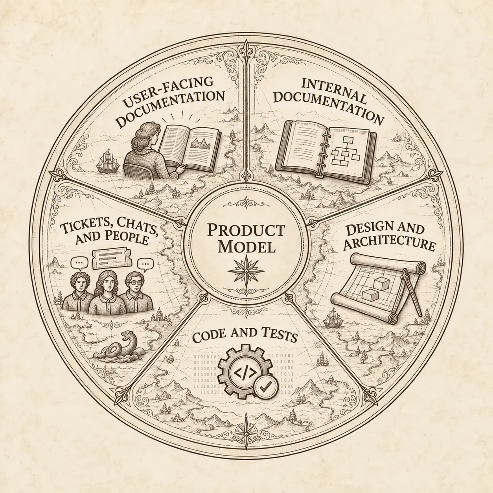
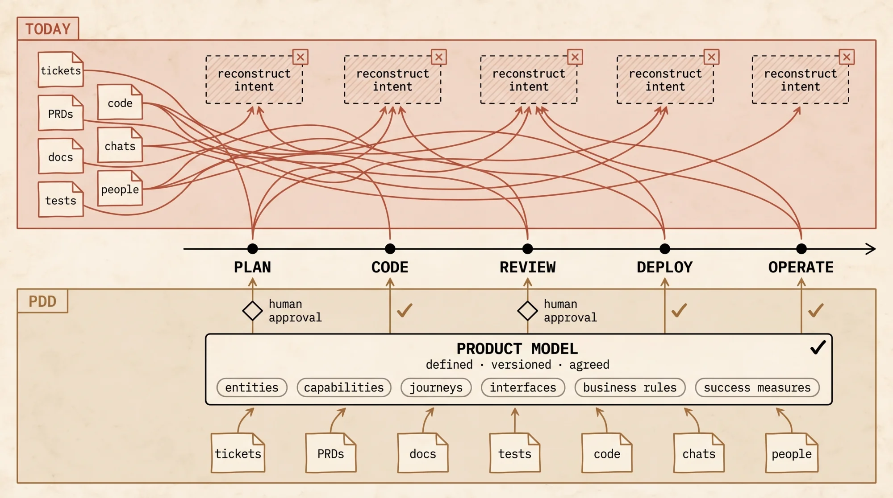

<p align="center">
  <a href="https://pdd-kit.dev">
    <picture>
      <source media="(prefers-color-scheme: dark)" srcset="./layers/nuxt/theme/public/brand/logo/lockup-dark.svg">
      
    </picture>
  </a>
</p>

<p align="center"><strong>Product-Driven Development for coding agents (OSS)</strong></p>
<p align="center">
The definition of your product already exists, just unstructured, incomplete and scattered across docs, code, tickets, chats and people.<br>
Every coding agent reconstructs it from scratch, and differently each time.<br>
PDD gives agents and humans a shared product model that is git-tracked, reviewable, and verifiable.
</p>

<p align="center">
  <a href="https://www.npmjs.com/package/pdd-toolkit"></a>
  <a href="https://github.com/itai-gendler/pdd-kit/actions/workflows/check.yml"></a>
  <a href="./LICENSE"></a>
</p>

<p align="center">
<code>npx pdd-toolkit install</code>
</p>

<p align="center">
<a href="#map-existing-repo-recommended"><strong>Map your own repo today!</strong></a>
</p>

<p align="center">
<a href="#the-problem">The problem</a> ·
<a href="#the-product-model">The Product Model</a> ·
<a href="#clear-product-model-focused-sources">Where it fits</a> ·
<a href="#example-the-product-model-of-a-kanban-board">Example</a> ·
<a href="#-get-started">Get started</a> ·
<a href="#the-development-loop">Development loop</a> ·
<a href="#faq">FAQ</a>
</p>

## The problem

The definition of your product already exists, just **unstructured, incomplete
and scattered** across docs, code, tickets, chats and people. Every **coding
agent reconstructs it** from scratch, and **differently each time**
([AI is writing code for products it doesn't understand](https://pdd-kit.dev/blog/your-agent-is-guessing)).

**Spec-driven development (SDD)** tools such as OpenSpec, spec-kit and Kiro
describe **each change**, with the product mixed into its design, plan and
tasks and spread across feature folders
([SDD describes the change, not the product](https://pdd-kit.dev/blog/pdd-and-spec-driven-development)).

**Product-Driven Development (PDD)** keeps the **product in one place**, apart
from how it's built: a shared product model for agents and humans that is
**git-tracked, reviewable and verifiable**
([Introducing pdd-kit](https://pdd-kit.dev/blog/introducing-pdd-kit)).

## The Product Model

`product-model/`, a [Product Model](https://pdd-kit.dev/docs/product-model):
one definition of what the product does, as plain Markdown next to the code. It
is made of:

- **[Entities](https://pdd-kit.dev/docs/entities):** what the product keeps, and who acts on it (Order, Customer, Payment provider).
- **[Interfaces](https://pdd-kit.dev/docs/interfaces):** how people and systems reach the product (Web app, Mobile app, Partner API).
- **[Domains](https://pdd-kit.dev/docs/domains):** the subject areas the product is split into (Ordering, Catalog, Billing).
- **[Capabilities](https://pdd-kit.dev/docs/capabilities):** what the product lets someone do (Check out, Cancel order, Refund).
- **[Journeys](https://pdd-kit.dev/docs/journeys):** one goal, carried across several capabilities (Browse and buy, Sign up, Reorder).
- **[Business rules](https://pdd-kit.dev/docs/business-rules):** what must always hold, and who may do what (Max 3 per order, Only managers refund, Total includes tax).
- **[Variations](https://pdd-kit.dev/docs/variations):** where the product works in more than one way (Feature flag, Plan tier, A/B test).

## Clear product model. Focused sources.

Bring knowledge from docs, designs, code, and people into one product model.
Fill gaps, clarify uncertainty, and make every source leaner and more focused.

<p align="center">
  
</p>

*Each information source’s purpose, supported by a shared product model*

| Information source | Purpose |
| --- | --- |
| **User docs** | Teaches people to use the product |
| **Internal docs** | Records architecture, design decisions, and onboarding |
| **Design & architecture** | Describes how it should look and work |
| **Code & tests** | Implements and verifies how it is built |
| **Tickets, chats & people** | Carry context, requests, and undocumented knowledge |

More in the FAQ: [Why a Product Model](docs/faq.md#why-a-product-model).

## Why a Product Model in the AI era

Agents write code faster than anyone can explain to them what the product is.
They fill the gaps by guessing, and the guesses ship.

1. **One definition.** Not scattered across tickets, docs, chats and people, but one model beside the code.
2. **Agents know what to build.** They read the Journeys, Scenarios and Rules instead of guessing.
3. **Done means it matches the product.** Verify checks the code against the approved model.
4. **Drift is easy to spot.** The model stays a clear reference as behavior changes.
5. **Decisions travel with the code.** Model and code changes are reviewed in one pull request.

<p align="center">
  
</p>

## Example: the Product Model of a kanban board

To show what a Product Model answers, here is one for a **kanban board**: a
conceptual product where a small team plans its work on shared boards of
columns and cards, and an **AI agent proposes the next cards**. It is the
[Kanban Board](https://github.com/itai-gendler/pdd-kit/tree/main/blueprints/kanban-board) Blueprint, a
model with no code behind it. Every answer below is read from the model.

<p align="center">
  
</p>

<p align="center">
<a href="https://pdd-kit.dev/blueprints/kanban-board"><strong>View the Kanban Board Product Model live</strong></a>
</p>

Or open it on your machine:

```bash
npx pdd-toolkit blueprint pull kanban-board
npx pdd-toolkit view
```

### 1. Entities, and which capabilities change them

All 9 entities in the kanban model: what the product keeps, and who acts on it.


Which capabilities create, change or remove each entity, filtered to the four
capabilities around a proposed card:

- **Card proposals** creates a proposed card, never a card.
- **Proposed card acceptance** is what turns it into a card on the board.
- **Proposed card dismissal** changes the proposal and leaves the board alone.


### 2. Capabilities, and which interfaces offer them

All 23 capabilities in the kanban model: what the product lets someone do.


Which interfaces offer each capability, filtered to six card capabilities:

- **The agent connection** offers one capability: proposing cards.
- **Every change to a card** happens in the board web application, by a member.


### 3. Business rules, and where they apply

All 32 business rules in the kanban model: what must always hold, and who may
do what.


Where each business rule is attached, filtered to the five attached to the
Proposed card entity:

- **Creating one:** only an AI agent a member connected proposes cards.
- **Deciding on one:** only the board's members accept or dismiss it.
- **Deleting one:** it goes only with its board.


### 4. An entity: what it keeps, and how its state changes

The Proposed card entity, one of the 9, and the information kept about it:

- **Four pieces of information:** its title, description, reason and suggested
  column.


How it moves through its states, and the capability behind every move:

- **Three states:** Proposed, then Accepted or Dismissed. Created and Removed
  mark where its life begins and ends.
- **Removing it** on its own is forbidden from every state; deleting its board
  removes it.


### 5. A capability's scenarios, and one step by step

The 4 scenarios of the Card proposals capability:

- **Four scenarios:** proposing cards for a goal, proposing a next step for a
  stalled card, and two refusals.


One of them, opened step by step:

- **Refuse a direct change from the AI agent:** the agent tries to move a card
  itself, and the product refuses. Every step says who acts, what is read,
  where, and which business rules govern it.
- **Its edge case:** editing, deleting or creating a card, or accepting its own
  proposal, is refused the same way.


## Who it helps

One shared definition of what the product does helps everyone who works on it:

- **Maintainers and reviewers** see a behavior change as a change to the model,
  reviewed in the same pull request as the code.
- **New contributors** learn what the product does, who may do what and where,
  without reading the whole codebase first.
- **Product managers and docs writers** find product answers in one place,
  with optional references to the code and material behind them.
- **Coding agents** read the scenarios and business rules before they change
  anything, instead of guessing. The `pdd-verify` skill checks the
  code against the model.

**Dogfooded:** pdd-kit is developed with pdd-kit. Its own Product Model
lives in this repository's [`product-model/` folder](./product-model/); open it
with `npx pdd-toolkit view itai-gendler/pdd-kit`.

## Features

* 🤖 **Agent skills:** map, ideate and verify for Claude Code, Codex, Cursor, Gemini CLI and GitHub Copilot

* 📝 **Markdown-native:** every resource is a plain `.md` file in your repo, reviewed in pull requests

* ✅ **Lint and verify:** `pdd-kit lint` checks the files; `pdd-verify` checks the code against them

* 🔁 **Fits your workflow:** implement with plan mode, an SDD tool or freestyle; PDD checks the code against the model as you go

* 🖥️ **Local report:** `pdd-kit view` opens the model in your browser and follows your edits

* 📦 **Blueprints:** start from a reviewed model for a common product instead of a blank page

* 🔒 **Local-first:** no account, no hosted service; the skills read your code and never run it

* 🆓 MIT-licensed and open source

---

##  Get started

```bash
npx pdd-toolkit install
```

This adds the skills to Claude Code, Codex, Cursor, Gemini CLI and GitHub
Copilot. Then start from where you are, inside your agent (Codex uses `$`
instead of `/`):

### Map existing repo (recommended)

Have code? Run the map skill:

```text
/pdd-map
```

It reads the code without running it, asks what the code can't answer, and
writes `product-model/` once you approve. Then open the report:

```bash
npx pdd-toolkit view
```

[From your repo](https://pdd-kit.dev/docs/from-your-repo)

### Start from an idea

No code yet? Describe the product you want:

```text
/pdd-ideate I want to build a booking app for dog walkers
```

You pick from a few product shapes, then approve the model.
[From an idea](https://pdd-kit.dev/docs/from-an-idea)

### Start from a Blueprint

A familiar kind of product? List the reviewed models and pull one:

```bash
npx pdd-toolkit blueprint list
npx pdd-toolkit blueprint pull <name>
```

[Browse the Blueprints](https://github.com/itai-gendler/pdd-kit/tree/main/blueprints) ·
[From a Blueprint](https://pdd-kit.dev/docs/from-a-blueprint)

## The development loop

<p align="center">
  
</p>

- **Ideate** (`/pdd-ideate`): the agent records the change in the model
  first, and nothing is written until you approve it.
- **Implement:** your agent builds it your way, in phases, with plan mode, an
  SDD tool, or freestyle.
- **Verify** (`/pdd-verify`): the agent checks the code against the
  model and fixes either one until they agree.

##  CLI

`install`, `update`, `lint`, `view` and the `blueprint` commands. Every command
and option: [CLI reference](https://pdd-kit.dev/docs/cli), or
`npx pdd-toolkit --help`.

## FAQ

Read the [frequently asked questions](docs/faq.md) about adopting pdd-kit,
what the Product Model covers, and getting help.

## License

pdd-kit is released under the **MIT License**: do anything, just give
credit. See [LICENSE](./LICENSE).
